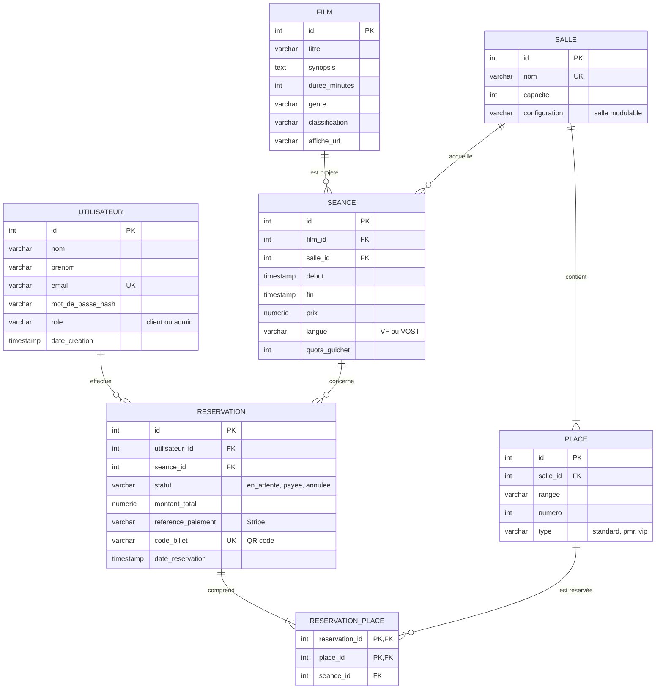

# Base de données – Le Grand Cinéma

SGBD : **PostgreSQL 16**. Fichiers :

- [`schema.sql`](schema.sql) : création des tables, contraintes, déclencheur et index.
- [`seed.sql`](seed.sql) : données de démonstration (10 salles, 1 700 places, films, séances, comptes).

Installation : `psql -d cinema -f schema.sql` puis `psql -d cinema -f seed.sql`.

## Schéma entité-relation

## Cardinalités (MCD)

| Entité A | Association | Entité B | Cardinalités |
|---|---|---|---|
| Utilisateur | effectue | Réservation | Un utilisateur fait 0 à n réservations ; une réservation appartient à 1 seul utilisateur |
| Film | est projeté | Séance | Un film a 0 à n séances ; une séance projette 1 seul film |
| Salle | accueille | Séance | Une salle accueille 0 à n séances ; une séance a lieu dans 1 seule salle |
| Salle | contient | Place | Une salle contient 1 à n places ; une place appartient à 1 seule salle |
| Séance | concerne | Réservation | Une séance reçoit 0 à n réservations ; une réservation porte sur 1 seule séance |
| Réservation | porte sur | Place | Une réservation porte sur 1 à n places ; une place est réservée 0 à n fois (une seule fois par séance) |

L'association « porte sur » (n, n) devient la table `reservation_place`.

## Règles métier garanties par la base

| Règle | Comment |
|---|---|
| Pas de double réservation d'une place pour une même séance | Contrainte `UNIQUE (seance_id, place_id)` sur `reservation_place` |
| Une place réservée appartient à la salle de la séance | Déclencheur `trg_place_dans_salle` |
| Deux séances ne se chevauchent pas dans la même salle | Contrainte d'exclusion `ex_seance_chevauchement` |
| La séance d'une place réservée est celle de sa réservation | Clé étrangère composée `(reservation_id, seance_id)` |
| Une annulation libère les places | Suppression des lignes de `reservation_place` |
| Pas de mot de passe en clair | Colonne `mot_de_passe_hash` (bcrypt) |
| Places gardées pour le guichet | Colonne `quota_guichet` sur `seance` (US9) |
